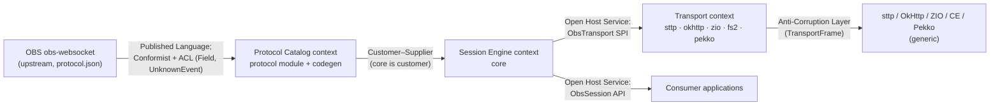
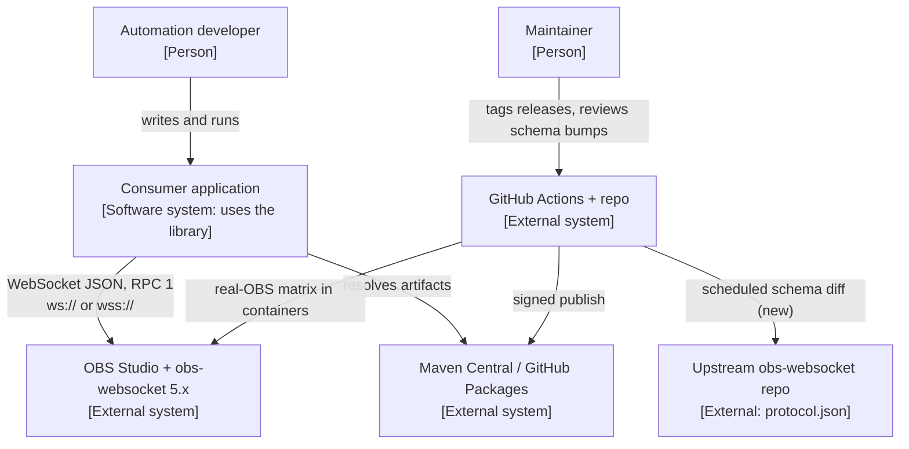
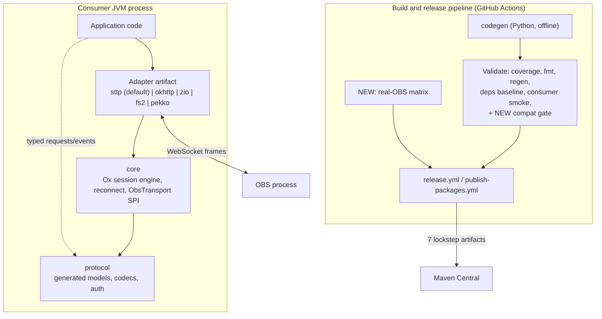
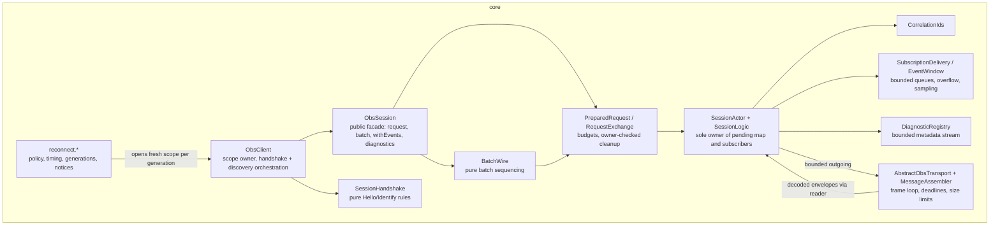
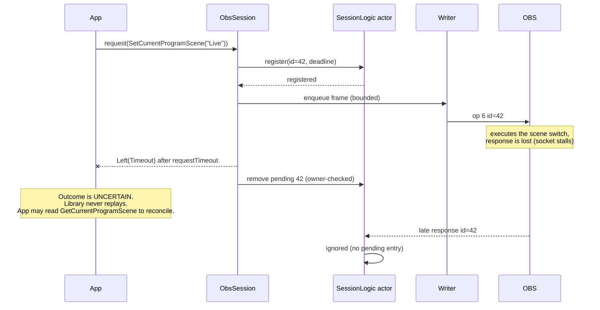
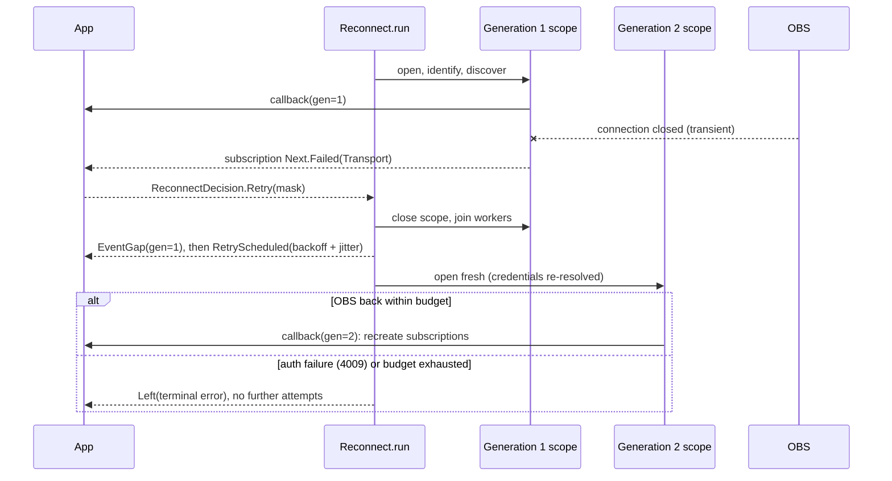

# OBS WebSocket Client — Design to 1.0

Status: proposal, 2026-10-24. Author: architecture review of `main` at `694d29b`.
Scope: where this library goes from the first published release (`0.3.0`, 2026-10-24) to a stable `1.0`, and what it deliberately does not become.

Labels used throughout: **[F]** fact from the repository, **[A]** assumption, **[D]** decision, **[Q]** open question, **[verify]** a third-party capability or fact to confirm before relying on it.

---

## 1. Summary

- **What:** a typed, scoped OBS Studio control library for Scala 3 on the JVM. It has 147 generated requests and 60 events, one Ox session engine, and five backend adapters. **[F]**
- **For whom:** JVM/Scala developers who automate live production: stream tooling, studio dashboards, bots, and event control rooms. **[A]**
- **Chosen direction:** *Stabilize, then grow only on evidence.* Freeze a deliberately narrowed public surface for 1.0, enforce it mechanically, prove real-OBS compatibility, and keep new capabilities (supervised sessions, effect-native facades, agent gateway) behind demand triggers.
- **Architecture style:** keep the existing **modular monolith library** (layered `protocol ← core ← adapters`, hexagonal transport seam, single actor-confined engine). No new runtime modules for 1.0.
- **Top 3 risks:** (1) adoption is too small to justify a 7-artifact, 100%-coverage maintenance load for one maintainer; (2) licensing of bindings derived from the GPL-2.0 schema is unresolved; (3) real-OBS compatibility rests on one manual smoke run (OBS 30.2.3, Linux).
- **First next step:** run the two cheap validations in parallel, both within 4 weeks. The **demand probe** is a 1.0 RFC plus Central download stats. The **licence determination** is a written question to upstream plus a maintainer review. Then start the API audit (M1).

---

## 2. Calibration, facts, assumptions, open questions

### Calibration: **M**

This is a published open-source library on Maven Central with (soon) external consumers. Once 1.0 ships, its public API and binary compatibility are one-way doors, so they need full analysis. It is not money- or safety-critical, there is no hosted service, and there is a single maintainer. Class L concerns are **n/a**: multi-region/DR has no servers, a capacity model is not needed for a client library, and there is no regulated data. The formal threat model is reduced to a STRIDE table.

### Facts (from the repository)

| # | Fact |
|---|---|
| F1 | Modules: `protocol`, `core`, `sttp`, `okhttp`, `zio`, `fs2`, and `pekko` are published. `codegen`, `examples`, and `server` are not. Dependency direction is `protocol ← core ← {sttp, zio, fs2, pekko}` and `sttp ← okhttp`. |
| F2 | Toolchain pins: Scala 3.9.0, Java 25 (`-release:25`), Mill 1.1.10, Ox 1.0.9, sttp 4.0.27, and jsoniter-scala 2.41.2. Python 3.14 is used for codegen only. |
| F3 | One `SessionLogic` actor owns all connection state. There is one reader, one serialized writer, bounded queues everywhere, and callback-scoped ownership (ADR-002). |
| F4 | The async adapters (zio/fs2/pekko) bridge into the same blocking `ObsSession` API. Effect-native facades were explicitly deferred (ADR-005). |
| F5 | A `private[client]` seam spans artifacts (`TransportFrame`, `AbstractObsTransport`, `MessageAssembler`, `HandshakeHeaders`, `JdkClientOptions`, and `reconnect.*`). Artifacts therefore release in lockstep. |
| F6 | Gates: exact 100% statement and branch coverage across 9 Scala modules plus the generator, `-Werror`, deterministic regeneration, a dependency baseline, an isolated consumer smoke test, and compiled doc snippets. |
| F7 | Release: a `vX.Y.Z` tag publishes to Central and GitHub Packages after full Validate, then runs a remote hash check and a consumer build. `release-recover.yml` exists for partial releases. |
| F8 | No binary/source-compatibility checker (MiMa or TASTy-MiMa) is configured. ADR-006 broke APIs in place, with "no stable baseline promised". |
| F9 | Real-OBS evidence covers OBS 30.2.3 / obs-websocket 5.5.2, Linux container, 4 scenarios. `real-obs.yml` is scheduled weekly but "has not yet run remotely". Windows/macOS have not been verified. |
| F10 | The schema `protocol.json` is GPL-2.0 upstream. Publishing to Central is gated on the repo variable `SCHEMA_LICENSE_REVIEWED`. First-party code is MIT. |
| F11 | Out of scope by statement: OBS 4.x, MessagePack, Scala 2, Scala.js, Scala Native, and automatic replay of uncertain writes. |
| F12 | The HTTP sample opens a fresh OBS connection per HTTP request. There is no shared long-lived session. |
| F13 | Project history starts 2026-10-04. A single committer appears in `git shortlog`. |

### Assumptions

| # | Assumption | If wrong |
|---|---|---|
| A1 | The goal of the next phase is a trustworthy 1.0, not feature breadth. | Re-run Phase 3 with "features" weighted higher. |
| A2 | The maintainer has roughly part-time capacity (a few hours a week) after the initial burst. | The roadmap stretches; cut Should items. |
| A3 | Current external usage is ≈ 0. `0.3.0` was published today. | Compatibility obligations start earlier. |
| A4 | Typical consumers run one or a few OBS connections per process and fewer than 50 requests/s. | Revisit the queue defaults and the single-actor design (see §7.4). |
| A5 | High-frequency OBS events (e.g. `InputVolumeMeters`) arrive about every 50 ms **[verify]**. | Recompute the overflow math in §7.4. |

### Open questions

| # | Question | Decision it affects |
|---|---|---|
| Q1 | Are MIT-licensed bindings generated from the GPL-2.0 `protocol.json` acceptable? This needs a maintainer or legal determination, not this document. | ADR-011; whether `protocol` can stay MIT and on Central. |
| Q2 | Is there real demand, and for which adapters and JVM baselines? | ADR-009 (adapter portfolio), ADR-010 (JVM/Scala baseline), and whether to go to 1.0 at all. |
| Q3 | Does upstream obs-websocket plan a breaking protocol (RPC 2 / 6.x) **[verify]**? | Timing of the 1.0 freeze and the shape of a multi-schema catalog. |
| Q4 | Does the Central Portal expose per-artifact download stats to namespace owners **[verify]**? | Instrument for the demand probe; otherwise use GitHub signals only. |
| Q5 | Does TASTy-MiMa (scalacenter) and a MiMa plugin exist for Mill 1.x **[verify]**? | How ADR-008 is implemented (plugin vs. a custom Mill task). |

---

## 3. Problem framing

### Input class

This is an **existing-system redesign / evolution**. The system works, is tested, and was just published. The question is not "what to build" but "what must be true for others to depend on it, and what to stop adding".

### Current state and pain points

| Pain point | Evidence | Consequence |
|---|---|---|
| No enforced compatibility contract | F8, ADR-006 | Every release can silently break consumers, so users cannot depend on it with confidence. |
| Large, uneven public surface | 147 generated methods, typed views, sampling, diagnostics, reserved `Connecting`/`Closing` states, raw APIs, 5 adapters × reconnect wrappers | Freezing everything at 1.0 freezes mistakes too. |
| Thin real-world evidence | F9 | The README's "typed control" promise is proven structurally, not against the OBS versions users run. |
| Licence uncertainty | F10 | A blocker for the protocol artifact, and transitively for every artifact. |
| Maintenance load vs. one maintainer | F6, F13; 5 backend ecosystems with independent release cadences | Dependency bumps × 100% coverage × lockstep releases mean the maintainer can burn out. |
| Narrow consumer baseline | F2: Java 25, Scala 3.9 | Shops on Java 21 / Scala 3.3 LTS cannot adopt it **[A]**. |
| Long-running apps must hand-roll supervision | F12, ADR-002 (callback must return `Retry`) | The most common app shape (an always-on dashboard or bot) has the most boilerplate. |

### Problem statement (JTBD)

> When I build tooling around a live OBS production, I want to control and observe OBS from my JVM service with types I can trust and failures I can reason about, so that a stream never breaks because my automation did something ambiguous.

Today users work around this with obs-websocket-js, goobs (Go), Python clients, or hand-rolled JSON over WebSocket. Those options are insufficient for JVM/Scala teams for three reasons. They need a second runtime. They lack typed nested models and scoped ownership. And none make "timeout ≠ not executed" explicit.

**5 whys** (why would someone *not* adopt this today?) → it is pre-1.0 → upgrades may break them → there is no compatibility contract → none was needed before publishing → **underlying need: a credible stability promise plus evidence it works on the user's OBS.** Features are not the bottleneck: the catalog is already complete relative to peers (`docs/feature-expansion.md`).

### Stakeholders that change the design

| Persona | Need that shapes the design |
|---|---|
| **Automation developer** (primary) | Stable API, the default sttp adapter, a simple long-running pattern |
| **Effect-stack developer** (ZIO/CE/Pekko) | Fits their runtime; today gets a blocking API (F4) |
| **Maintainer** (single) | Low toil per release; mechanical gates instead of manual review |
| **Upstream obs-websocket** | Licence terms; protocol evolution |

### Success metrics

- **Primary outcome:** number of distinct external projects depending on any artifact 3 months after 1.0, measured by GitHub dependents, Central stats **[verify Q4]**, and issues from non-maintainers. The target is set after the demand probe (§5). It is not invented here.
- **Guardrails:** zero unintended binary breaks within 1.x (MiMa gate); real-OBS matrix green for every supported OBS version on each release; maintainer time per patch release ≤ 1 hour of manual work **[A]**; 100% coverage gate kept.

### Riskiest assumptions (impact × uncertainty)

| Rank | Assumption | Type | Impact | Uncertainty |
|---|---|---|---|---|
| 1 | JVM/Scala users want an OBS client enough to adopt a niche library | Desirability | High | High |
| 2 | Schema-derived bindings can be published under MIT | Viability | High (blocks everything) | Medium-high |
| 3 | One maintainer can sustain 7 lockstep artifacts across 5 ecosystems | Feasibility | High | Medium |
| 4 | Behavior holds on OBS versions beyond 30.2.3 and on Windows/macOS | Feasibility | Medium | Medium |
| 5 | The bridged blocking API is acceptable to effect-stack users | Desirability | Medium | Medium |

---

## 4. Ideas and evaluation

### Divergent directions (generated without judgement)

1. **Stabilize for 1.0.** Narrow and freeze the surface, add a compatibility gate and a real-OBS matrix, and publish a stability policy.
2. **Effect-native facades.** `ZIO`/`IO`/`Source`-shaped APIs per ecosystem, possibly over an extracted sans-IO session core.
3. **Supervised session and studio state replica.** A long-lived, auto-recovering handle that maintains a live read model of scenes, inputs, and outputs from events, so apps query state instead of polling.
4. **OBS control gateway for agents and automation.** Productize the HTTP sample into a standalone service (HTTP + MCP tool server **[verify MCP Java/Scala SDK maturity]**) so LLM agents and non-JVM tools can drive OBS safely, with policy and audit.
5. **`obsctl` CLI.** A native-image or JVM CLI for scripting OBS from shells and CI.
6. **Cross-platform reach.** Scala.js/Native builds, or lowering the JVM to 21 and Scala to an LTS line.
7. **Don't build more: maintenance mode.** Freeze at 0.x, accept PRs only, and point users to obs-websocket-js/goobs for missing needs.
8. **Upstream-first.** Contribute typed schema improvements (nested object definitions) to obs-websocket so every client benefits.

**Techniques applied.** *Inversion:* how do we guarantee nobody adopts it? Break the API every release, support only Java 25, and never test real OBS. Directions 1 and 6 address this. *Constraint flip, 10× users:* the binding constraint is stability and support, not throughput. *Constraint flip, zero budget:* direction 7. *No UI:* direction 4 for agents.

**Feature brainstorm for the top directions.** Direction 1: API dump diff, MiMa/TASTy-MiMa, `@unstable` marker, an OBS version matrix, schema-bump bot, migration guides, and a support policy. Direction 3: `ObsSupervisor`, a `StudioState` replica with versioned snapshots, change streams, health probes, and a "desired state" reconciler (differentiator). Direction 4: allow-listed request policy, dry-run, audit log, per-tool rate limits, and an MCP tool catalog generated from the schema (differentiator).

### Evaluation matrix (1–5, higher is better; Effort and Risk are inverted, so 5 means low effort or low risk)

| Direction | User value | Feasibility | Effort | Risk | Differentiation | Constraint fit | Total |
|---|---|---|---|---|---|---|---|
| 1 Stabilize 1.0 | 4: unlocks adoption, the stated bottleneck | 5: tooling exists | 4: mostly gates + audit | 4: known work | 3: table stakes, but rare among peers | 5: matches ADRs | **25** |
| 2 Effect-native | 3: only effect-stack users | 3: duplicates correlation unless sans-IO | 2: per-ecosystem work × coverage gate | 3 | 3 | 2: contradicts ADR-005 deferral | 16 |
| 3 Supervisor + replica | 4: removes the biggest boilerplate | 4: builds on reconnect | 3 | 3: replica correctness vs. event gaps | 4 | 4: additive | 22 |
| 4 Agent gateway | 3: speculative audience | 3: a new service with auth and ops | 2 | 2: security-sensitive, new product | 5 | 2: becomes an ops product | 17 |
| 5 CLI | 2: obs-cmd-style tools exist **[verify]** | 4 | 4 | 4 | 1 | 3 | 18 |
| 6 Cross-platform / lower baseline | 3: wider reach | 2 for JS/Native (Ox is JVM-only **[verify]**); 4 for JVM 21 | 3 | 3 | 2 | 2: F11 excludes JS/Native | 15 |
| 7 Maintenance mode | 1 | 5 | 5 | 3: project withers | 1 | 4 | 19 |
| 8 Upstream-first | 3: indirect | 2: depends on upstream acceptance | 3 | 3 | 2 | 4 | 17 |

**Primary: 1, Stabilize for 1.0.** It is the cheapest path to the primary metric. It directly attacks riskiest assumption #2 (licence must be resolved to ship) and #4 (matrix). It also creates the instrument for #1.

**Runner-up: 3, Supervisor + state replica.** It lost because it adds API surface right before a freeze. Every new public type at 1.0 becomes a compatibility obligation, and it would be designed before any user has asked for it. **It wins if** the demand probe shows long-running apps are the dominant use case (≥ half of RFC respondents **[A]**). It then ships as an additive module in 1.1, so 1.0 does not need it.

Direction 7 is the explicit fallback if the demand probe fails (see §5).

### Kano and MoSCoW for the 1.0 scope

| Feature | Kano | MoSCoW (1.0) |
|---|---|---|
| Documented stability policy (what is stable, what is `@unstable`, support window) | Basic | **Must** |
| Binary + TASTy compatibility gate against the last stable release | Basic | **Must** |
| Licence determination recorded, publish gate kept | Basic | **Must** |
| Real-OBS matrix: ≥ 2 OBS major lines, automated, green | Basic | **Must** |
| Public API audit: remove or hide reserved/accidental API; consistent naming across adapters | Performance | **Must** |
| Lockstep version enforcement for the `private[client]` seam | Basic | **Must** (largely exists, F7) |
| Migration guide 0.x → 1.0 | Performance | **Should** |
| Scheduled schema-diff job that opens a PR on upstream change | Performance | **Should** |
| Windows/macOS smoke for the default sttp adapter | Performance | **Should** |
| Performance regression budget on existing JMH benches | Performance | **Could** |
| `ObsSupervisor` + `StudioState` replica | Delighter | **Won't (1.0)**: candidate for 1.1 |
| Effect-native facades | Delighter for a segment | **Won't (1.0)** |
| Agent/MCP gateway, CLI, Scala.js/Native | Delighter | **Won't** |

---

## 5. MVP scope and validation experiment

The "MVP" here is **1.0-RC1**: the Must rows above, released as `1.0.0-RC1`. It tests riskiest assumption #1 (do people adopt when stability is promised?) and #2 (can we legally ship it?).

### Cheapest experiments, before the API audit starts

| # | Experiment | Cost | Validates | Pass / fail rule |
|---|---|---|---|---|
| E1 | **Demand probe.** Publish a "Road to 1.0" GitHub Discussion with 4 questions (use case, adapter, JVM version, Scala version). Announce on Scala community channels. Watch GitHub stars, dependents, and Central stats **[verify Q4]** for 4 weeks after 0.3.0. | ~2 h | Desirability (#1), adapter usage (#5), baseline (§ADR-010) | **Pass:** ≥ 5 distinct external users or projects respond or depend **[A: threshold chosen by maintainer; 5 is a placeholder]** → proceed with M1–M3. **Fail:** switch to direction 7 and keep 0.x with best-effort patches. |
| E2 | **Licence determination.** Ask upstream obs-websocket maintainers in writing how they view licensing of generated client bindings. Check the licences of established generated clients (obs-websocket-js, goobs) **[verify]**. Record the maintainer's determination (legal advice if needed). | ~2 h + wait | Viability (#2) | **Pass:** recorded determination supports MIT bindings. **Fail:** apply the ADR-011 fallback. |
| E3 | **Matrix spike.** Make `real-obs.yml` run remotely once on OBS 30.2.3 plus one newer OBS line installable in the container **[verify which versions Debian/PPA/Flatpak expose]**. | ~1 day | Feasibility (#4) | **Pass:** both green in GitHub Actions within the job time limit. |
| E4 | **Baseline spike.** Compile and run the full suite with `-release:21` on Temurin 21. | ~0.5 day | Reach (ADR-010) | Record what breaks. No change is shipped from this spike alone. |

---

## 6. Domain model (DDD)

### Event Storming-lite (one connection generation, in time order)

| # | Domain event | Command (actor) | Policy ("whenever X, then Y") |
|---|---|---|---|
| 1 | `ConnectRequested` | `connect(config)(use)` (App) | — |
| 2 | `TransportOpened` | upgrade (Adapter) | Whenever the upgrade exceeds its deadline → fail with `Timeout`; abort. |
| 3 | `HelloReceived` | — (OBS) | Whenever Hello arrives → resolve the password and send Identify. |
| 4 | `Identified` | — (OBS) | Whenever the negotiated RPC ≠ 1 → `IncompatibleProtocol`, terminal. |
| 5 | `CapabilitiesDiscovered` | raw `GetVersion` (Client) | Whenever discovery succeeds → invoke the app callback. |
| 6 | `RequestRegistered` | `request` / `batch` (App) | Whenever pending ≥ `maxInFlight` → `Overflow`. |
| 7 | `RequestSent` | — (Writer) | Whenever a write stalls past its deadline → abort the connection. |
| 8 | `ResponseCorrelated` / `RequestTimedOut` | — | Whenever a timeout occurs → remove only that entry; the outcome stays **uncertain**. |
| 9 | `EventReceived` → `EventBroadcast` | — (OBS) | Whenever a subscriber queue is full → fail that subscriber, or count drops under an explicit policy. |
| 10 | `ConnectionLost` | — | Whenever the error is transient and budget remains → `RetryScheduled` (reconnect only). |
| 11 | `EventGapReported` | — | Emitted before a committed retry of a completed generation. |
| 12 | `GenerationStarted` (n+1) | — (Reconnect loop) | Credentials resolved afresh; local subscriptions must be recreated. |
| 13 | `SessionClosed` | callback exit (App) | Logical close → physical close → join workers. |

**Aggregates.** These are the consistency boundaries.
- `ConnectionGeneration`: phase, negotiated metadata, and discovered capabilities. Owned by the `SessionLogic` actor.
- `PendingRequest`: correlation ID, deadline, and owner.
- `Subscription`: filter, queue, overflow policy, and drop count.
- `ReconnectRun`: attempt budget, backoff state, and stability timer.

**Read models.** `SessionStats`, `ConnectionState`, `availableRequests`, and the diagnostics stream. Post-1.0 candidate: `StudioState`.

### Subdomains

| Subdomain | Type | Strategy |
|---|---|---|
| Session engine: correlation, ownership, backpressure, reconnect semantics | **Core** | Build and invest; this is the differentiator (explicit uncertainty, bounded everything). |
| Protocol catalog and code generation | Supporting | Build simply; generated from the upstream published language. |
| Transport adapters | Supporting | Thin anti-corruption layers over sttp/OkHttp/ZIO/fs2/Pekko. |
| JSON codec, WebSocket I/O, concurrency runtime | Generic | Buy/OSS: jsoniter-scala, sttp, Ox. |
| Release and compatibility verification | Supporting | Build simply; it is CI scripts. |

### Bounded contexts and context map



The catalog conforms to the upstream schema; it does not redesign it. However, it shields consumers through an ACL: `Field.Missing/Null/Value`, exact `BigDecimal`, `UnknownEvent`, and lossless views. Adapters translate each library's frames and errors into the neutral `TransportFrame`. **[F]**

---

## 7. Architecture drivers

### Key use cases (prioritized)

1. **UC1:** Connect, authenticate, discover capabilities, and run typed requests (e.g. switch scene, read inputs).
2. **UC2:** Subscribe to typed events and react (e.g. scene changed → update overlay).
3. **UC3:** Run a long-lived automation that survives OBS restarts (reconnect with generations and event gaps).
4. **UC4:** Upgrade the library within 1.x without code changes or rebuild surprises. *(New and central to this design.)*
5. **UC5:** Use a newer OBS that has unknown fields or requests (raw APIs and lossless views).
6. **UC6:** Run atomic-looking multi-step changes (serial batches with halt/continue).
7. **UC7:** Pick the adapter that matches the app's stack.
8. **UC8 (maintainer):** Bump the upstream schema or a backend dependency and release safely.

### Quality attributes (ranked; these cannot all be maximized)

| Rank | Attribute (ISO 25010) | Scenario: source / stimulus / environment / artifact / response / **measure** |
|---|---|---|
| 1 | **Reliability: fault tolerance and correctness of control** | OBS / drops the connection mid-request / normal operation / session engine / pending requests fail with a typed error, nothing is replayed, workers are joined / **0 duplicate mutations; 0 leaked threads after scope exit; 100% of in-flight calls resolve within `requestTimeout` + shutdown grace.** |
| 2 | **Compatibility: API stability** (maintainability / modifiability) | Maintainer / releases 1.x.y / CI / published artifacts / the gate blocks any binary or TASTy-incompatible change to the stable surface / **0 unflagged incompatibilities across 1.x; detected pre-merge.** |
| 3 | **Maintainability: maintainer toil** | Maintainer / bumps sttp or the OBS schema / normal week / build + tests / changes are localized; gates explain failures / **routine bump ≤ 1 h hands-on; a schema bump touches only `protocol-spec/`, overrides, fixtures, and docs.** |
| 4 | **Interoperability / portability** | User / runs against OBS line *N* on Linux, Windows, or macOS / production / adapter + engine / handshake, discovery, and scene round-trip work / **matrix green for every OBS line listed as supported.** |
| 5 | **Performance efficiency** | App / sends 50 req/s and consumes high-rate events / same host as OBS / engine / bounded memory, no head-of-line blocking from slow subscribers / **library overhead ≤ JMH baseline + 20% [A: budget]; memory per session bounded by config (§7.4).** |

**Explicit conflicts and resolutions.**
- *Compatibility (2) vs. maintainability (3):* a frozen surface makes cleanup harder. → Freeze less: mark experimental areas `@unstable` and exclude them from the gate (ADR-008/009).
- *Reliability (1) vs. performance (5):* single-actor confinement serializes routing. → Accepted. A4's load is far below actor limits; revisit only on measured contention.
- *Portability (4) vs. maintainability (3):* 5 adapters × N OBS lines × 3 OSes would explode the matrix. → Run the full OBS matrix on sttp only. The other adapters keep the deterministic cross-backend contract suite (F: `sttp/test` contract suite).

### Constraints

- **Technical:** Scala 3, JVM, Ox direct style, and Mill only (ADR-001). OBS WebSocket 5.x / RPC 1 JSON only (F11).
- **Organizational:** one maintainer (F13). The 100% coverage gate is a self-imposed constraint and is kept.
- **Regulatory/legal:** GPL-2.0 upstream schema (F10).
- **Budget:** $0 beyond free GitHub Actions minutes **[A]**.
- **Timeline:** none imposed. This design suggests about one quarter to 1.0 **[A]**.

### Back-of-envelope capacity

- **Request load:** with A4 at ≤ 50 req/s and OBS on localhost/LAN, Little's law gives `in-flight ≈ rate × latency = 50 × 0.02 s ≈ 1` (assuming a 20 ms RTT **[A]**). Against `maxInFlight = 256`, there is ~250× headroom. Overflow is only reachable if OBS stalls: 50 req/s × 5 s stall = 250, which reaches the limit at ~5 s. That is correct behavior (fail fast).
- **Event load:** with A5 at 20 meter events/s and an assumed ~2 KB payload with ~10 inputs **[A]** → ~40 KB/s. A stalled subscriber with `subscriptionCapacity = 128` overflows in `128 / 20 = 6.4 s`. **Memory per subscriber** is ≤ 128 × 2 KB ≈ 256 KB. This is why sampling and drop policies exist for meter events; document this math in `events.md`.
- **Outgoing:** `outgoingCapacity = 256 × maxMessageBytes`. This is the worst-case bound only; the actual default for `maxMessageBytes` should be quoted from `protocol` **[verify value]**.
- **Cost envelope:** CI only. A weekly real-OBS matrix of 2 OBS lines at ~15 min each **[A]** costs ~2 h/month of Actions time, within the free tier for public repos **[verify current terms]**.

---

## 8. Options and trade-offs

These are candidate styles for the 1.0 engine. All are hexagonal at the transport seam.

| | **A. Status quo, hardened:** one Ox engine; bridged adapters; modular-monolith library | **B. Effect-polymorphic core:** tagless-final `F[_]` engine; native per ecosystem | **C. Sans-IO core:** a pure session state machine (inputs → state + outputs); thin runtime per ecosystem (Ox, ZIO, CE) |
|---|---|---|---|
| Reliability (1) | **5:** one proven implementation, 100% covered | 3: semantics re-proven per `F` | 4: pure core is testable, but each runtime re-implements scheduling, timeouts, and joins |
| API stability (2) | **5:** one public API | 2: type-class surface is hard to keep binary-stable | 3: two public layers (pure + runtime) |
| Maintainer toil (3) | **4** | 1: ecosystems × coverage | 2: N runtimes × coverage |
| Interop (4) | 4: blocking API everywhere | **5** | **5** |
| Performance (5) | 4: bridge hop on async adapters | 5 | 5 |
| Team fit | **5:** exists; matches ADR-001/005 | 1: contradicts ADR-001 | 3 |
| Migration cost | 0 | Rewrite | Large refactor of `SessionLogic` (partially started: handshake rules split out, `c4243fa`) |

**[D] Select A.** It maximizes the top three ranked attributes and costs nothing to keep. C is the designated evolution path *if* effect-native demand appears. The recent split of pure handshake rules is a cheap step in that direction and should continue opportunistically without making the pure core public.

**Sensitivity points (what would flip the choice):**
- ≥ 30% of RFC respondents or adopters are on ZIO/CE and reject the blocking API → move toward C for 2.0 **[A threshold]**.
- A second maintainer joins and owns an ecosystem → C becomes affordable.
- Upstream ships a breaking protocol (Q3) → the engine changes anyway; prefer to do C then.

---

## 9. Architecture

### 9.1 C4 Level 1: System context



### 9.2 C4 Level 2: Containers

For a library, the "containers" are its artifacts at runtime inside the consumer's JVM, plus the build/release pipeline.



### 9.3 C4 Level 3: Components of the core (Session Engine context)



**Stability classification [D] (input to ADR-008/009):**

| Component | 1.0 stability |
|---|---|
| `ObsClient`/adapter `connect`, `ObsSession` request/batch/events, `ObsConfig`, `ObsError`, `Next`, `RequestOptions`, `OverflowPolicy`, `reconnect` public types, generated requests/events | **Stable** |
| Sampling (`SampledSubscription`), typed nested views, workflow helpers, diagnostics payload shape | **`@unstable`** in 1.0; promote in a minor once used |
| `ConnectionState.Connecting` / `Closing` (reserved, never entered) | **Remove before 1.0** (or document as stable-but-unreachable; removal is cheaper now) |
| `private[client]` seam (F5) | **Internal**; excluded from the gate; lockstep versions |

### 9.4 Key flows

**Flow 1: mutation request, failure path (lost response → uncertain outcome)**



**Flow 2: OBS restart under the reconnect wrapper**



**Flow 3: release with partial-publish failure (maintainer flow, one-way door: Central is immutable)**

```mermaid
sequenceDiagram
    participant M as Maintainer
    participant GH as GitHub Actions
    participant C as Maven Central
    M->>GH: push tag v1.0.0
    GH->>GH: validate.yml on tag SHA (all gates + compat gate)
    GH->>GH: validate_release.py (7 modules, versions, CHANGELOG)
    GH->>C: one signed bundle, auto-release
    alt Central accepts bundle
        GH->>C: verify_published (hash 28 files, ≤30 min)
        GH->>GH: isolated consumer from Central, then GitHub Release
    else upload or verification fails
        GH-->>M: job red; no GitHub Release
        M->>GH: release-recover.yml (resume, never re-version)
    end
```

### 9.5 Data

The library holds no persistent data. **[F]**

| Context | Data | Storage | Consistency | Owner |
|---|---|---|---|---|
| Session engine | Pending requests, subscribers, stats, phase | In-memory, actor-confined | Strong within one generation (single writer); **nothing** survives a generation | `SessionLogic` |
| Reconnect | Attempt count, backoff, stability timer | In-memory per `run` | Single-threaded loop | `Reconnect.run` |
| Catalog | Schema, overrides, provenance (SHA-256) | Git (`protocol-spec/`) | Pinned, deterministic | Maintainer |
| Release evidence | Coverage reports, smoke evidence, compat reports | CI artifacts | Per run | CI |

**Schema evolution.**
- Wire to library: forward-compatible by design (unknown fields retained, unknown events preserved, enums keep unknown values).
- Library to consumer: governed by ADR-008.
- Adding an upstream field to a generated case class changes its constructor and `copy`, which is **binary-breaking** for consumers who construct or pattern-match it. **[D]** Generated *response* and *event* types are stable for reading (field accessors) but not for construction or exhaustive matching. Document this in the stability policy and configure the gate to allow new fields there. Request constructors use defaulted `Field.Missing` parameters **[verify current codegen shape]** so new optional request fields stay source-compatible. **[Q]** Whether binary compatibility can be kept for request constructors needs E4-style spike work under the compat gate (see risk R6).

Retention: n/a. There is no stored data.

### 9.6 Integration and APIs

- **App → library:** synchronous, direct-style. Expected errors are returned as `Either[ObsError, A]`; defects and interruption propagate. Contract-first via the generated catalog. **[F]**
- **Library → OBS:** asynchronous on the wire, sync to the caller via correlation IDs. Idempotency: none at the protocol level. **[D]** This is kept explicit; no auto-replay (ADR-002). The readiness retry applies to reviewed reads only.
- **Timeouts:** separate connect, handshake, request, write, and shutdown deadlines. **Backpressure:** bounded queues with `Overflow`. **Failure isolation:** a slow subscriber fails only itself. **[F]**
- **Versioning:** artifacts use early-semver now and full semver from 1.0. All 7 versions move in lockstep (F5). The protocol catalog version (upstream revision) is reported in `provenance.json` and should be **exposed at runtime** as `Catalog.revision` so apps can log it **[D, small, two-way]**.
- **SPI:** `ObsTransport` is public (third-party transports allowed, ADR-001). `AbstractObsTransport` is internal. **[D]** At 1.0, `ObsTransport` is stable. Third parties implement the trait without the shared loop and accept that they reimplement deadlines.

### 9.7 Security and privacy

**Authentication:** OBS challenge/salt (SHA-256) via `Authentication.scala`. The password comes from `PasswordProvider` and is resolved per generation. **Authorization:** n/a in the library; OBS grants full control to any authenticated client **[F, upstream model]**. **Data classification:** the password is secret. Scene and input names may be personal (stream content) and are kept out of diagnostics by design. **Secrets:** the library never persists them; release secrets live only in GitHub Actions secrets (F7).

| Trust boundary | STRIDE threat | Mitigation | Status |
|---|---|---|---|
| App ↔ OBS over the network | **S**poofing (rogue OBS on the LAN) | `wss://` with TLS options on owned JDK clients; document that `ws://` is LAN-trust only | Exists; strengthen docs |
| | **T**ampering / **I**nfo disclosure (`ws://` plaintext) | Recommend TLS via a reverse proxy; the password never travels in the clear (challenge-response) | Exists |
| | **D**oS (malicious or buggy server floods or sends huge frames) | `maxMessageBytes`, bounded decode (308-digit mantissas), bounded queues, write-deadline abort | Exists |
| Library ↔ app | **I**nfo disclosure (password in logs, `toString`) | Redacting `toString` on secret holders; test it | **[verify]**; add a fitness test |
| Supply chain (build → Central) | **T**ampering | Signed artifacts, attestations, hash-verified publish, hash-locked Python, weekly OSV scan | Exists |
| | **E**levation (compromised maintainer token) | Narrow-scope Central user token; tag protection rules **[verify enabled]**; required review on `release*.yml` changes | Add tag protection |
| HTTP sample | **E**levation (bound to a public interface → anyone controls OBS) | Binds `127.0.0.1` by default; README warns; no auth by design | Exists; keep as a sample only |

**Regulatory:** n/a for the library. The licensing obligation (GPL-2.0 schema) is handled in ADR-011.

### 9.8 Observability and reliability

A library has no SLOs of its own. It owes consumers **SLIs they can compute** plus internal budgets.

| SLI (exposed) | Source | Suggested consumer SLO (documented example) |
|---|---|---|
| Request success ratio by `ObsError` kind | `SessionStats`, diagnostics | ≥ 99.9% non-`Timeout` on localhost **[A]** |
| Request latency (registration → response) | Diagnostics metadata | p99 < 100 ms on localhost **[A]** |
| Event drops per subscriber | `droppedEvents` counters | 0 for control events; bounded for meters |
| Reconnect attempts / `EventGap` count | `ReconnectNotice` | Alert on > N/hour |

**Logs/metrics/traces:** the library emits no logs itself; it exposes bounded diagnostics instead (ADR-004). **[D]** Add an optional, separate `obs-websocket-client-otel` module only on demand (deferred). **Failure modes and degradation** are as in §9.4: fail fast on overflow, fail the subscriber not the session, terminal versus transient classification.

### 9.9 Deployment and operations (library release engineering)

- **Topology:** artifacts on Maven Central and GitHub Packages. Docs site built by `site.build`.
- **Environments:** local (`publishLocal` + consumer smoke) → CI Validate → tag release. There is no staging repo because Central bundles are validated before release **[F]**.
- **CI/CD:** the existing workflows, plus a **compat gate** in `validate.yml` and a **real-OBS matrix** promoted from scheduled/manual to a required check on release tags (ADR-012).
- **Configuration:** `OBS_RELEASE_VERSION` from the tag.
- **Rollback:** **Central is immutable** (one-way door), so rollback means publishing `x.y.(z+1)` that reverts the change. Document this in `releases.md`. GitHub Packages versions can be deleted, but treat them as immutable for parity.
- **Backup/restore:** the signing key is backed up by the maintainer (F7). **[Q]** Record a second key holder or escrow, because of bus factor.

### 9.10 Technology stack

| Concern | Recommendation (driver) | Credible alternative |
|---|---|---|
| Language/runtime | Scala 3.9 on Java 25, kept for 1.0 (ADR-010: raising later breaks, lowering later doesn't) | Scala 3.3 LTS + Java 21 for reach (E4) |
| Concurrency | Ox structured concurrency (QA1, ADR-001) | Raw virtual threads + `StructuredTaskScope` **[verify JDK 25 status]** |
| WebSocket | sttp 4 sync + JDK `HttpClient` default (QA3: fewest deps) | OkHttp (already shipped) |
| JSON | jsoniter-scala core, hand-written/generated codecs (QA5, small POMs) | circe (slower, heavier) |
| Build | Mill 1.1.x (ADR-001) | sbt (wider ecosystem tooling) |
| Codegen | Python + Jinja, offline and pinned (ADR-003) | Scala generator inside Mill (removes the Python toolchain; revisit if Python maintenance hurts) |
| Compat gate | MiMa + TASTy-MiMa as a Mill task (QA2) **[verify Q5]** | API-dump text diff (javap/TASTy signature listing) checked into git |
| Real-OBS tests | Disposable Debian container + Xvfb (F9) | Self-hosted runner with a GPU/desktop for Windows/macOS |

---

## 10. ADRs (new; continuing the series in `docs/decisions/`)

### ADR-007: Keep the single Ox engine with bridged adapters for 1.0
- **Status:** Proposed.
- **Context:** QA1–QA3 rank reliability, stability, and toil above interop. Options A/B/C are in §8.
- **Decision:** 1.0 ships option A. Pure rules continue to move out of `SessionLogic` internally (towards C), with no public pure API.
- **Consequences:** + One proven semantics. + One public API. − Effect users get a blocking API. − A bridge hop.
- **Alternatives:** B (tagless-final), C (sans-IO public core).
- **Revisit when:** a sensitivity point in §8 fires.
- **Door:** two-way before 1.0; effectively one-way after it (the API shape is frozen).
- **Drivers:** QA1, QA2, QA3, constraint "one maintainer".

### ADR-008: 1.x compatibility contract, mechanically enforced
- **Status:** Proposed.
- **Context:** F8, UC4, QA2. Central is immutable.
- **Decision:**
  - Within 1.x, the **stable surface** (§9.3 table) stays binary- and TASTy-compatible.
  - Breaking changes require 2.0.
  - A compat gate in `validate.yml` compares each artifact to the latest stable release. Implement it with MiMa + TASTy-MiMa **[verify Q5]**; otherwise use a checked-in API dump diff.
  - Exclusions: the `private[client]` seam (F5), `@unstable` APIs, and reading-only generated response/event types for *added* fields (§9.5).
  - All 7 artifacts share one version; `validate_release.py` already enforces this (F7).
- **Consequences:** + Users can upgrade blindly within 1.x. − Mistakes in the stable surface persist until 2.0, hence ADR-009. − Gate maintenance (filters).
- **Alternatives:** documentation-only promise (unenforceable for one maintainer); per-artifact independent versions (impossible while the seam spans artifacts).
- **Door:** **one-way** (a public promise).
- **Drivers:** UC4, QA2, QA3.

### ADR-009: Narrow the stable surface before freezing
- **Status:** Proposed.
- **Context:** Surface breadth (pain point 2). ADR-006 shows the API still drifts.
- **Decision:**
  - Run an API audit (M1). Remove the reserved, unreachable `ConnectionState` variants.
  - Unify reconnect `run` shapes, including Pekko where feasible.
  - Mark sampling, typed nested views, workflow helpers, and diagnostics payload shapes `@unstable`. Use a custom annotation, not Scala's `@experimental`, which forces consumers into experimental mode **[verify current Scala 3.9 semantics]**.
  - Use **download/RFC evidence** at RC1 to keep or demote adapters. The default is to keep all five; an adapter with no signal may be published but labeled "community-maintained" (best-effort fixes, still under the compat gate).
- **Consequences:** + A smaller promise. − One more 0.x breaking release (0.4.0) before RC.
- **Alternatives:** freeze everything (locks in mistakes); drop adapters now (no evidence yet).
- **Door:** two-way for the annotations (promote later); one-way for the removals once 1.0 ships.
- **Drivers:** QA2, QA3, riskiest assumption #3.

### ADR-010: Keep the Java 25 / Scala 3.9 baseline for 1.0, and decide on lowering by evidence
- **Status:** Proposed.
- **Context:** The narrow baseline limits reach (pain point 6). **Raising** a baseline later breaks consumers; **lowering** it later is compatible.
- **Decision:**
  - Keep Java 25 / Scala 3.9 for 1.0.
  - Run spike E4. If the RFC shows ≥ 30% of respondents blocked on Java 21 **[A threshold]** and E4 shows a small change set, lower to Java 21 in a 1.x minor.
  - Same rule for Scala: confirm whether 3.9 is the next LTS line **[verify]**.
- **Consequences:** + No irreversible choice is made without data. − Early adopters on Java 21 are excluded until then.
- **Alternatives:** lower now (spends effort before demand is known); cross-build (doubles the matrix).
- **Door:** two-way in this direction.
- **Drivers:** riskiest assumption #1, QA3.

### ADR-011: Licence determination is a hard 1.0 gate
- **Status:** Proposed. Outcome pending (Q1).
- **Context:** F10. The bindings derive from the GPL-2.0 `protocol.json`. This document does not give a legal opinion.
- **Decision:**
  - Keep the `SCHEMA_LICENSE_REVIEWED` gate.
  - Before RC1, record a written determination (E2) in `protocol-spec/README.md` covering the reviewer, date, and reasoning.
  - Ordered fallbacks if the determination is negative:
    - (a) Generate bindings from an independently authored, MIT-licensed interface description (clean-room from public docs). This is expensive.
    - (b) License `protocol` under GPL-compatible terms and document the impact on consumers. This likely kills adoption.
    - (c) Stop publishing `protocol` and generate in the consumer's build (build-time plugin). This adds complexity.
- **Consequences:** + Removes a latent existential risk. − It may block 1.0 for an unknown duration.
- **Door:** one-way (published artifacts cannot be withdrawn from Central).
- **Drivers:** riskiest assumption #2.

### ADR-012: Real-OBS evidence is a release gate for 1.0+
- **Status:** Proposed.
- **Context:** F9, QA4.
- **Decision:**
  - The `real-obs` workflow runs on sttp against **every OBS line listed as supported**. At least two lines are required: 30.2.x plus the newest packaged line **[verify availability]**.
  - It is required for release tags; a weekly schedule catches drift.
  - Results are written into `docs/compatibility.md` by script, not by hand.
  - Windows/macOS: documented as "community-verified" until a runner exists (Should).
  - Other adapters rely on the deterministic cross-backend contract suite.
- **Consequences:** + Claims match evidence. − Releases depend on container OBS packaging (flaky risk R5). − Longer release runs.
- **Alternatives:** manual smoke before each release (toil, skipped under pressure); a full matrix for every adapter (cost × 5).
- **Door:** two-way (a CI policy).
- **Drivers:** QA4, UC5.

### ADR-013: Defer supervised sessions, effect-native facades, and the gateway
- **Status:** Proposed.
- **Context:** §4 runner-up analysis; prime directive "simplest that meets drivers".
- **Decision:** none of these ship in 1.0. Each has an explicit trigger (§10 deferred table). When one is built, it ships as an **additive module** on top of the stable `core`, never as changes to the engine.
- **Consequences:** + 1.0 sooner with a smaller promise. − Long-running apps keep the reconnect boilerplate. Mitigation: a documented "supervisor recipe" in `recipes.md` using the existing reconnect API.
- **Door:** two-way.
- **Drivers:** QA2, QA3.

### Deferred decisions and their triggers

| Decision | Trigger that forces it |
|---|---|
| `ObsSupervisor` + `StudioState` module (direction 3) | ≥ 3 independent requests, or long-running apps are ≥ 50% of RFC respondents |
| Sans-IO extraction made public; effect-native facades | §8 sensitivity points |
| Drop or demote an adapter | RC1 evidence (ADR-009), or an upstream backend that stops releasing for Scala 3 |
| Lower the JVM/Scala baseline | ADR-010 thresholds |
| Multi-schema catalog (RPC 2 / obs-websocket 6) | Upstream announces a breaking protocol (Q3) |
| Replace the Python codegen with Scala | Python toolchain causes ≥ 2 release delays |
| OpenTelemetry module | A user asks for traces/metrics export |
| Relax the 100% coverage gate (e.g. ≥ 98% plus mutation testing) | Coverage chores exceed ~30% of maintainer time for a quarter |
| Agent/MCP gateway (direction 4) | External sponsorship or ≥ 3 requests; it would be a separate repository |

---

## 11. Risks, pre-mortem, fitness functions

### Pre-mortem: "it is 2027-10 and the project failed". Most likely causes:

1. Nobody adopted it. It stayed a portfolio piece, and 1.0 effort went into a promise nobody needed.
2. The licence question surfaced after 1.0 and forced the protocol artifact to be withdrawn or relicensed.
3. The maintainer burned out on dependency bumps across five ecosystems, each needing 100% coverage, and releases stopped.
4. OBS 31/32 changed behavior (field renames, new auth) that structural tests could not see; users hit runtime failures and left.
5. 1.0 froze an awkward API (reconnect callback ergonomics), and the only fix was 2.0.
6. A Java 25-only baseline excluded the users who did show up.

### Risk register

| # | Risk | Likelihood | Impact | Mitigation | Owner | Early-warning signal |
|---|---|---|---|---|---|---|
| R1 | No adoption | High | High | E1 demand probe; fallback to maintenance mode | Maintainer | < 5 external signals 4 weeks after the probe |
| R2 | Licence incompatibility | Medium | Critical | ADR-011 gate before RC | Maintainer (+ legal advice) | Upstream reply negative or silent > 4 weeks |
| R3 | Maintainer toil and burnout | Medium | High | Lockstep automation, Renovate/Scala Steward-style bumps **[verify Mill support]**, adapter demotion policy | Maintainer | Dependency PRs open > 30 days |
| R4 | OBS behavior drift | Medium | Medium | ADR-012 matrix; scheduled schema diff | CI | Weekly matrix red; upstream revision moves |
| R5 | Flaky container OBS tests block releases | Medium | Medium | Retry once; pin image digests; manual override with a recorded reason | Maintainer | > 1 flaky failure/month |
| R6 | Codegen output is binary-incompatible on each schema bump | High | Medium | §9.5 policy; compat gate filters for generated types; test on the first schema bump after 1.0 | Maintainer | Compat gate red on a schema-only PR |
| R7 | Bus factor 1 (signing key, Central namespace) | Medium | High | Second key holder or escrow; document the recovery path | Maintainer | — (structural) |
| R8 | Backend ecosystem breaks (Pekko/ZIO/CE majors) | Low-Medium | Medium | Adapters isolated; contract suite; demotion policy | Maintainer | Upstream major announced |

### Fitness functions

| Protects | Fitness function | Status |
|---|---|---|
| Dependency direction (`protocol ← core ← adapters`; no effect runtime in core/protocol/sttp/okhttp) | Dependency baseline check on published POMs | Exists |
| QA1 reliability | 100% statement and branch coverage; deterministic peer fault tests; cross-backend contract suite | Exists |
| QA1 leak-freedom | Test asserting no live non-daemon threads after `connect` returns, across all adapters | **Add [verify whether it partly exists]** |
| QA2 stability | MiMa + TASTy-MiMa against the last stable release, per artifact, in Validate | **Add (ADR-008)** |
| QA2 seam containment | A check that no public signature in an artifact exposes a `private[client]` seam type | **Add** |
| QA4 interop | Real-OBS matrix required on tags | **Add (ADR-012)** |
| QA5 performance | JMH benches (envelope, dispatch, assembler) compared to a stored baseline; fail on > 20% regression **[A]** on a pinned runner, otherwise report-only | **Add, report-only first** (shared CI runners are noisy) |
| Security | Redaction test for password-bearing types; OSV weekly; signed and attested artifacts | Partly exists |
| Catalog determinism | Regeneration check plus provenance SHA-256 | Exists |
| Docs truth | Compiled snippets; compatibility page generated from matrix evidence | Partly exists |

### Spikes, ordered by risk reduction

1. **E2 licence** (removes the existential risk).
2. **E1 demand** (decides whether to continue at all).
3. **E3 matrix** (proves QA4 is feasible in CI).
4. **Compat-gate spike** (Q5): MiMa/TASTy-MiMa on Mill 1.1 against `0.3.0`, and observe what a simulated schema bump does (R6).
5. **E4 baseline**.

---

## 12. Roadmap

**Walking skeleton:** already exists. The library is published, with a tag-driven release through every container (codegen → protocol → core → adapters → Central → consumer smoke). The remaining "thin slice" is the *compatibility* path, so M0 builds that end-to-end first.

| Milestone | Scope | Exit criteria | Validates |
|---|---|---|---|
| **M0: Validate (≈ 4 weeks)** | E1 RFC, E2 licence query, E3 matrix spike, compat-gate spike against 0.3.0 | Licence determination recorded or a fallback chosen; demand signal measured; matrix green remotely on 2 OBS lines; compat gate runs in CI (report-only) | Riskiest assumptions #1, #2, #4 |
| **M1: Audit and narrow → 0.4.0** | ADR-009 audit; remove reserved states; unify reconnect `run`; `@unstable` annotation; `Catalog.revision`; redaction and leak tests; supervisor recipe in docs | 0.4.0 released; the CHANGELOG lists every break with a migration | #3; API shape |
| **M2: Gates → 1.0.0-RC1** | Compat gate enforcing against 0.4.0; real-OBS required on tags; adapter keep/demote decision; stability policy page; migration guide | RC1 on Central; no compat-gate violations between RC1 and the final release; ≥ 1 external consumer upgrades from 0.3/0.4 **[A]** | QA2, QA4; real upgrade path |
| **M3: 1.0.0** | Fixes from RC feedback only | 4 weeks of RC without a breaking change; licence gate green; matrix green | Stability promise |
| **M4: 1.x by evidence** | Whichever deferred trigger fires first: supervisor module, Java 21 baseline, Windows/macOS runner | Per-feature ADR | Adoption growth |

**Not now:** effect-native facades; public sans-IO core; agent/MCP gateway; CLI; Scala.js/Native; MessagePack; OBS 4.x; automatic replay of uncertain writes; an OpenTelemetry module; any change that adds a runtime dependency to `core` or `protocol`.

---

## 13. Glossary

| Term | Meaning |
|---|---|
| **Session** | A callback-scoped, identified connection to OBS (`ObsSession`); it cannot escape its callback. |
| **Generation** | One connection attempt's lifetime under the reconnect wrapper; state never crosses generations. |
| **Capability discovery** | The raw `GetVersion` after Identify; yields `availableRequests` used to gate typed requests. |
| **Pending request** | A registered, correlated request awaiting its response; removed on response, timeout, or cancel. |
| **Uncertain outcome** | A mutation whose response was not received; it may or may not have executed. Never replayed. |
| **Raw request / raw event** | An untyped escape hatch for extensions and newer OBS; it bypasses the capability gate. |
| **Overflow policy** | What happens when a subscriber's bounded queue is full: fail it (default) or drop with a counter. |
| **Sampling** | Opt-in latest-per-key event windows for high-rate events; lossy by design. |
| **Readiness retry** | Bounded retries of reviewed read requests after OBS answers NotReady (code 207). |
| **EventGap** | A notice that events between two generations may have been missed. |
| **Event mask / subscriptions** | The server-side event categories requested at Identify/Reidentify. |
| **Field (Missing / Null / Value)** | The tri-state for optional wire fields, preserving the omitted vs. null distinction. |
| **Catalog** | The generated requests, events, and enums from the pinned `protocol.json` revision. |
| **Adapter** | A published artifact implementing `ObsTransport` for one WebSocket backend. |
| **Seam (`private[client]`)** | Internal types shared across artifacts; they force lockstep versioning and are excluded from compatibility promises. |
| **Stable / `@unstable` surface** | The API covered or not covered by the 1.x compatibility contract (ADR-008/009). |
| **Lockstep** | All seven artifacts always share one version number. |
